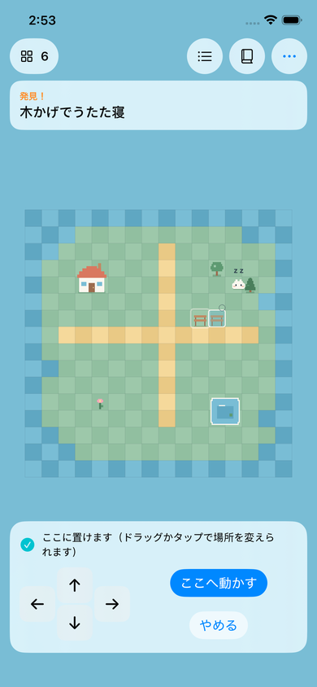
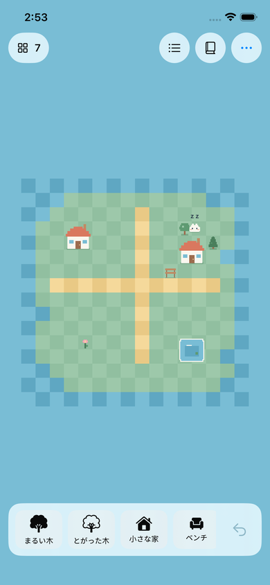

# 2026-10-25 Swift CI整備とP0箱庭Vertical Slice実装報告

- 作成日時: 2026年10月25日 23時36分19秒（JST、作業環境の `date` で取得）／最終更新: 2026年10月25日 23時56分37秒
- ブランチ / PR: `claude/hibimachi-p0-impl-auviod` / https://github.com/naki0227/hibimachi/pull/1
- 目的: 機能より先にSwift CIを整え、AI・写真・SNS・認証・課金・同期なしで「置いて、生き物が反応する」箱庭P0を遊べる状態にする。

## 変更（コミット単位）
1. `ci:` Xcodeプロジェクト（app / unit test / UI test、shared scheme）、ローカルSwift Package `HibimachiCore`、`.swift-format`、`scripts/ci/swift-quality.sh`、`.github/workflows/swift-ci.yml`、ADR-0002。
2. `feat(core):` Domain（地形・配置物・`World`検証）、`WorldEditor`（Undo 20段）、`CreatureBrain`（状態機械・4反応）、座標/カメラ計算、`GameStore`、JSON保存（schema v1、原子的書き込み、退避）、unit test 61件。
3. `feat(app):` SpriteKit描画（色ブロックのピクセル風仮アート）、入力（タップ/ドラッグ/ピンチ）、SwiftUI HUD（パレット・確定ボタン・矢印・選択バー・Undo・図鑑・一覧・トースト・保存エラー）、アプリunit test、UI test 3件。
4. `docs:` ADR-0003、本報告、TODO/ROADMAP/README更新。
5. `fix(app):` `IslandScene.bounds` が `UICoordinateSpace.bounds`（CGRect）と衝突しXcode 26.5でビルド失敗 → `cameraBounds` に改名。
6. `fix:` CIのSimulatorスクリーンショット確認で発見した3件（下記）を修正。

## 設計意図
- ルールは `HibimachiCore`（SpriteKit/SwiftUIをimportしない）に閉じ込め、Linuxでも `swift test` できる。SceneはStoreの状態を差分描画し入力を委譲するだけ（ADR-0002/0003）。
- 誤操作対策: タップ・ドラッグはプレビューを動かすだけで、確定は必ず「ここに置く」ボタン。置けない理由を文章と ○/× で表示し、確定ボタンは無効化。
- 面白さの仕掛け: 初期島ではベンチ・木・池の3反応がすぐ見られ、**花をベンチの隣に置くと反応が変わる**（`bloom-bench`）。図鑑には未発見の件数を出さない。

## 検証（実行コマンドと結果）
| 項目 | コマンド / 場所 | 結果 |
|---|---|---|
| format | `scripts/ci/swift-quality.sh format-check`（Linux, swift 6.3.3） | PASS |
| lint | `scripts/ci/swift-quality.sh lint` | PASS |
| core unit test | `swift test --package-path HibimachiCore`（Linux） | 61件 PASS |
| docs | `python3 scripts/verify_docs.py` / `python3 -m unittest discover -s scripts -p 'test_*.py'` | PASS |
| CI（`ci:`コミット e1c70ea） | GitHub Actions Swift CI（Linux + macOS-26 / Xcode 26.5 / iPhone 17e iOS 26.5） | 全job success |
| CI（最終 head `24b2288`） | Swift CI run #5 / Docs quality / GitGuardian | 全job success（core 62件、app unit 6件、UI 3件） |

- core unit test は修正後 62件（Linuxでローカル実行 PASS）。

### CIは緑だったがスクリーンショットで見つけた不具合（修正済み）
CI run #4（`4e5fd81`）は全job successだったが、UI testのスクリーンショットを目視確認して以下を発見した。
1. **移動プレビューが常に「動かすものが見つかりません」**: `previewIssue` の `flatMap ... ?? .unknownObject` で、有効（nil）な場所が未検出扱いになり確定ボタンが常に無効。UI testは「無効ならキャンセル」の分岐で素通りしていた → 分岐を削除して成功を必須化し、core testで有効/重なりの両方を検証（修正前のコードで失敗することを確認済み）。
2. **生き物が画面上で動かない**: `CreatureNode` が毎フレーム move action を作り直し、SpriteKitが進める前に削除していた → 目標タイルが変わった時だけ開始。app unit testで同一actionが維持されることを検証。
3. **編集バーの日本語ボタンが3行に折り返す** → 矢印を44ptに縮め、確定/やめるを縦積みに。

修正後（run #5）のSimulator（iPhone 17e / iOS 26.5）スクリーンショット:

| ベンチを移動中・生き物は木かげで昼寝 | 再起動後に配置（家）が復元 |
|---|---|
|  |  |

- 反応バランス（一時的なテストで計測、コミットしていない）: 初期島・200 seedで初回発見までの中央値7tick（約3秒）、90パーセンタイル14tick、最大62tick（約28秒）。10分あたりの反応はベンチ約17回・木約12回・池約10回、中断0回。

## 未実施と理由
- **実機プレイテスト・ゲーム性の評価**: 実機がなく、この作業環境はLinux。ジェスチャーの操作感、小画面での誤タップ率、楽しさはSimulatorのUI test/スクリーンショットのみで、人による検証はしていない。
- **ローカルでのXcodeビルド・Simulator起動**: 作業環境にXcodeがないため、iOSのbuild/testはGitHub ActionsのmacOS Runnerだけで実施。
- VoiceOver・Dynamic Typeの実操作確認、Reduce Motionの目視確認、性能（fps/メモリ）計測。
- 最小チュートリアル（ROADMAP Stage 1）と2〜5人のプレイテスト。

## リスク・注意点
- CIが緑でもUIの不具合を見逃しうる（上記1・2）。UI testは「成功を必須にする」書き方を守り、スクリーンショットの目視確認をPRごとに行う。
- 手書きのpbxprojをXcodeで開くと書式が書き換わることがある（差分はレビューで確認）。
- CIのmacOS jobは私有リポジトリでは分数消費が大きい（Linuxの10倍換算）。
- 仮アート（色ブロック）はオリジナル。既存ゲームの画像は使っていない。

## Rollback
- 機能をやめる: `feat(app)` と `feat(core)` を revert（`ci:` は残せる）。保存ファイルは `Application Support/Hibimachi/world.json` のみで、アプリ削除で消える。

## 次回最初に読む / 実行する
- 読む: `TODO.md` → `docs/adr/0003-p0-game-state-and-persistence.md` → `HibimachiCore/Sources/HibimachiCore/UseCases/GameStore.swift`
- 実行: `swift test --package-path HibimachiCore`、`scripts/ci/swift-quality.sh lint`、macOSなら `xcodebuild test -project Hibimachi.xcodeproj -scheme Hibimachi -destination 'platform=iOS Simulator,name=iPhone 17e,OS=26.5'`
