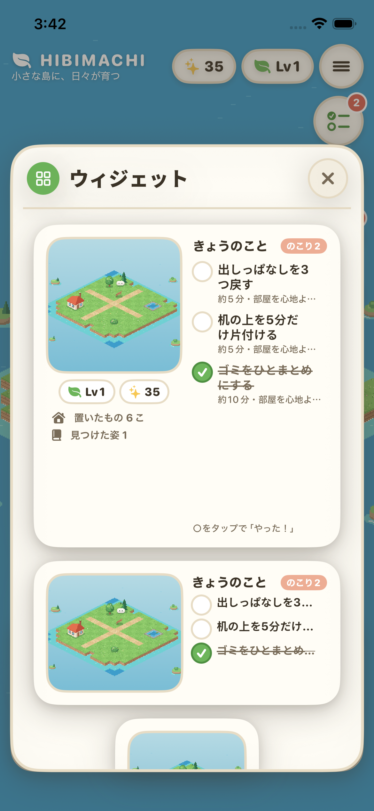

# 2026-10-26 独自ゲームUIへの置き換えとホーム画面ウィジェット 作業報告

- 作成日時: 2026年10月26日 12時36分17秒（JST）
- ブランチ / PR: `claude/hibimachi-p0-impl-auviod` / PR #1
- 依頼（ユーザー）: (1)「ポップアップのUIが気に入らない。デフォルトのを使っているでしょ」 (2)「ウィジェットで使えるようにしたい。大きめのウィジェットは左に箱庭、右にtodoリスト」

## 変更（コミット単位）
1. `0beca27` 独自UIキット（`Shared/GameStyle.swift`: 色・丸ゴシック・押し込みボタン・紙のパネル）と `ModalLayer`。シート・List・Menu・確認ダイアログ・アラート・標準ボタンをすべて置き換え。目標の新規作成はパネル内に表示（シートの入れ子をやめた）。スワイプ操作・折りたたみ・メニューは見えるボタンに変更。
2. `f938b76` コア: `QuestBoard`（今日のクエストのチェックリスト）、`WorldRepository.peek()`（副作用なしの読み込み）、`QuickQuestCompletion`（アプリ外での達成。同じ報酬規則）、`GameStore.reloadProgressFromStorage()`。テスト7件を追加。
3. `584d664` ウィジェット拡張 `HibimachiWidgetExtension`（小・中・大）、App Intent による達成、保存先を App Group へ移動、島の絵の書き出し、アプリ内のデバッグ用プレビューとUIテスト。
4. `1fefe13` ADR-0006、DATA-MODEL、TODO。
5. `13948e2` 修正: 島の絵の切り抜きで型を取り違えていた（CIのiOSビルドで検出）。
6. `7c2d01b` ウィジェット大サイズの見た目修正（島の枠を正方形にして拡大、置いたもの数・発見数を追加、見出しを1行に）。

## 設計の要点（ADR-0006）
- 保存は App Group コンテナの `Hibimachi/world.json`。旧保存は1回だけ移動し、失敗したら旧フォルダを使い続ける。App Group が無いビルドでは従来の保存先。
- ウィジェットは `peek()` で読むだけ。壊れたファイルの退避や新しい島の作成はしない。
- ○タップ → `CompleteQuestIntent` → `QuickQuestCompletion`。1日1クエスト1回・1達成1報酬はアプリと同じ。
- 書き込みの競合を避けるため、アプリは `.background` のときだけ保存し、`.active` に戻ったら読み直す（保存失敗中は読み直さない）。
- 島の絵はアプリを離れる瞬間（`.inactive`）に昼の色で撮り、最大幅640pxのPNGにする。

## 検証
| 項目 | 結果 |
|---|---|
| `swift test --package-path HibimachiCore`（Linux, Swift 6.3.3） | 104件 PASS（追加7件） |
| format-check / lint（ローカル） | PASS |
| Swift CI（head `13948e2`、`ff52952`）: Linux / iOS build・app unit・UI test 6件 | success |
| Demo video（head `13948e2`） | success |
| UI test `testWidgetPreviewShowsIslandAndTodaysQuests` | PASS（目標作成→1件達成→プレビューで「のこり2」と表示） |
| `0beca27` 時点の CI（UI置き換えのみ） | success。デモ動画をユーザーへ送付 |

## 未実施・残課題
- **実機・署名付きビルドでのウィジェット確認は未実施**。CI は署名なし（`CODE_SIGNING_ALLOWED=NO`）なので App Group が無く、ホーム画面のウィジェットは「アプリをひらいて」状態になる。見た目はアプリ内プレビュー（同じビュー・実データ）でのみ確認。
- ○タップでの達成（App Intent）は単体テスト（`QuickQuestCompletion`）でのみ確認。ウィジェット上での動作は未確認。
- Application Support からの保存移動も実機では未確認。
- iPad の分割表示など「アプリが前面のままウィジェットが書く」状況は考慮していない（ADR-0006 の見直し条件）。

## 次に読むもの・コマンド
- `docs/adr/0006-home-screen-widget-and-shared-save.md`、`Shared/IslandWidgetView.swift`、`HibimachiWidget/HibimachiWidget.swift`
- 実機で試すとき: Xcode の Signing & Capabilities で Hibimachi と HibimachiWidgetExtension の Team を選ぶ（App Group `group.dev.naki0227.hibimachi` が登録される）。
- `swift test --package-path HibimachiCore` / `scripts/ci/swift-quality.sh format-check`
