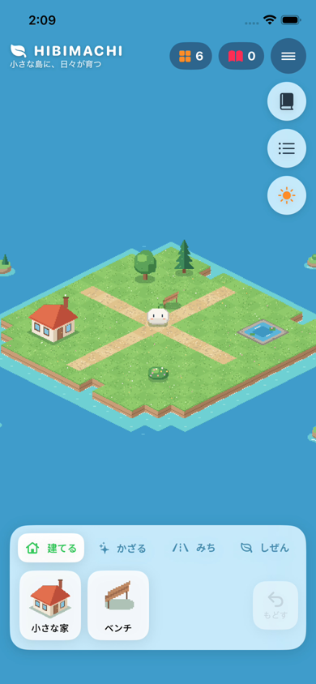

# 2026-10-26 アイソメトリック化・デモ動画 作業報告

- 作成日時: 2026年10月26日 11時15分04秒（JST）
- ブランチ / PR: `claude/hibimachi-p0-impl-auviod` / PR #1（P1は未着手。ブランチの分け方はユーザー回答待ち）
- 目的: ユーザーの依頼「デモ動画を見て判断する」に応えて動画を作る。続けて提示されたモックアップ2枚（アイソメトリックの浮島、タブ付きパレット、昼夜など）に見た目を近づける。

## 変更（コミット単位）
1. `ci:` `DemoUITests`（台本どおりに操作するUIテスト）と `demo-video.yml`（`simctl io recordVideo` で録画。PRに `demo-video` ラベルが付いたときと手動実行のときだけ動く）。通常のCIはこのテストを除外する。
2. `feat(core):` `IsoGrid`（アイソメ投影・逆変換・描画順）、小道ペイント（草地⇔小道、Undo対象に地形を追加）、`DayPhase`、ランプ。テストは73件。
3. `feat(app):` コード描画のピクセルアート（`PixelCanvas` / `ObjectSprites` / `TerrainArt`）。崖・浅瀬・遠くの小島・水面のきらめき・昼夜の色調と灯り・発見カードの写真・タブ付きパレット・モックアップ風のUI。
4. `fix(app):` 録画を見て直したもの。CIのSimulatorがUTCで夜表示になっていた件、島が小さく見える件、発見写真の切り出し位置のずれ、生き物が小さい件、選択バーの名前が切れる件。
5. ADR-0004、VISUAL-DIRECTION の更新。

## 検証
| 項目 | 結果 |
|---|---|
| `swift test --package-path HibimachiCore`（Linux） | 73件 PASS |
| format-check / lint | PASS |
| Swift CI（head `541b747`）: Linux / iOS build・unit・UI test（iPhone 17e / iOS 26.5） | success |
| Demo video（head `541b747`） | success。約1分40秒に切り詰めてユーザーへ送付 |

## 未実施・残課題
- モックアップの描き込み密度（柵・桟橋・船・滝・崖の岩など）には届いていない。本番のアセットをどう作るか（アーティストに頼む／生成AIで作って加工する／コード描画を続ける）はユーザーが決める必要がある（ADR-0004）。
- モックアップにある通貨チップ（コイン・芽・花）はP1の経済設計（共通資源1種）と食い違っている。P1で決める。
- 実機での操作感（菱形タイルのタップ精度、初期ズーム）は未確認。
- 発見カードは、写真の撮影（0.8秒後）より先に表示されたとき、仮のアイコンのままになることがある（図鑑には写真が入る）。

## 次回最初に読む / 実行する
- `docs/adr/0004-isometric-view-and-code-drawn-pixel-art.md` → `Hibimachi/Scene/ObjectSprites.swift`
- 動画の再録画: PR に `demo-video` ラベルを付けて push する（またはmainへのマージ後に手動実行）。
