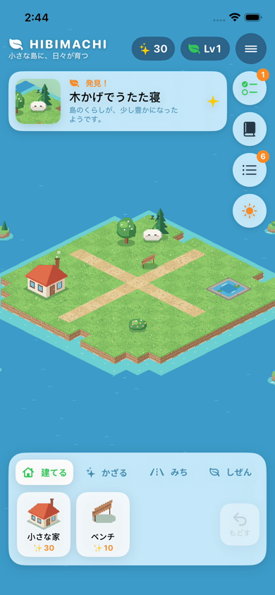

# 2026-10-26 P1（目標・小クエスト・きらめき）とアートの磨き込み 作業報告

- 作成日時: 2026年10月26日 11時49分16秒（JST）
- ブランチ / PR: `claude/hibimachi-p0-impl-auviod` / PR #1
- ユーザー決定（2026-10-26）: (1) 絵はコード描画を磨き続ける、(2) 報酬は全行動で手に入る共通資源1種、(3) PR #1 に積む。

## 変更（コミット単位）
1. `feat(core):` `PlayerProgress`（目標・クエスト・達成・報酬台帳・持ち物）、`DailyPlanner`、`LocalDay`、`RewardRule`。保存 schema v2 と v1 からの自動移行。ADR-0005。
2. `feat(app):` 「きょうのこと」シート（目標カテゴリを選ぶ→今日の3クエスト→「やった！」／「ほかの」／取り消す）、ヘッダーのきらめき・Lvチップ、パレットの値段・手持ち数の表示、確定ボタンの「✨10で置く」。
3. `feat(app):` アートの磨き込み（草の房、岩の積み重なった崖、海の波模様、煙突の煙、花の咲いた木）。
4. 修正: アプリテストのリポジトリ型、報酬行の識別子の取り違え、デモ台本の手順（お金が足りない項目）、発見カードの出入りで右側のボタンがずれる問題（UIテストで検出）。

## 設計の要点（ADR-0005）
- きらめきは1種類で、どのカテゴリのクエストでも同額（20 XP + 5）。残高は台帳から計算し、別に保存しない。
- 同じ達成IDへの二重付与と、同じクエストの同日2回達成は拒否する。取り消しは当日分だけで、きらめきを使っていたら取り消せない。
- 建物は買うと手持ちに入り、「しまう」と手持ちに戻る（返金なし、何度でも無料で置き直せる）。置けない場所では何も消費しない。
- はじめに きらめき30を贈る。「島をはじめから」でも稼いだものは消えない。

## 検証
| 項目 | 結果 |
|---|---|
| `swift test --package-path HibimachiCore`（Linux） | 97件 PASS |
| format-check / lint | PASS |
| Swift CI（head `20b83b2`）: Linux / iOS（app unit 7件・UI test 5件） | success |
| Demo video（head `20b83b2`） | success。約2分15秒に切り詰めてユーザーへ送付 |

## 未実施・残課題
- 実機での確認（操作感・性能・VoiceOver）。
- 経済の数値（価格と報酬の比率）は暫定値で、7日間テストでの調整が必要。挑戦・継続ボーナスは未実装（公平性を確認してから）。
- 「クエストが終わったら、新しい建築案や発見候補をさりげなく示す」（GAME-DESIGN P1）は未実装。
- 台帳は増え続ける（長期的には締め処理を検討）。

## 次回最初に読む / 実行する
- `docs/adr/0005-p1-single-currency-and-inventory.md` → `HibimachiCore/Sources/HibimachiCore/Progress/PlayerProgress.swift` → `Hibimachi/Views/QuestSheet.swift`
- `swift test --package-path HibimachiCore`
