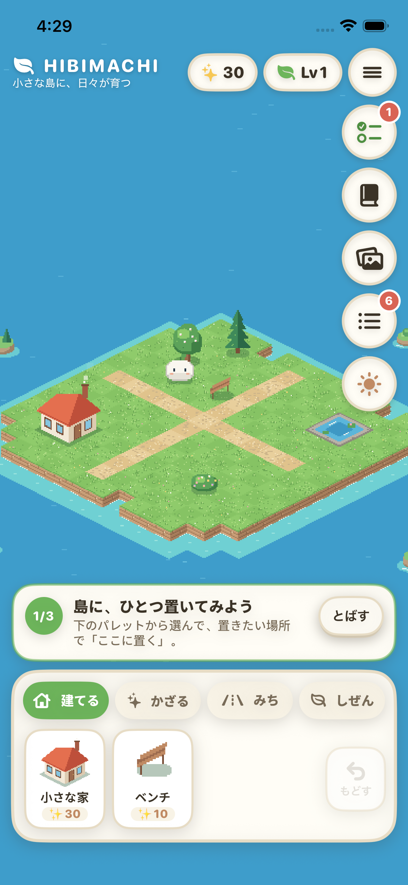
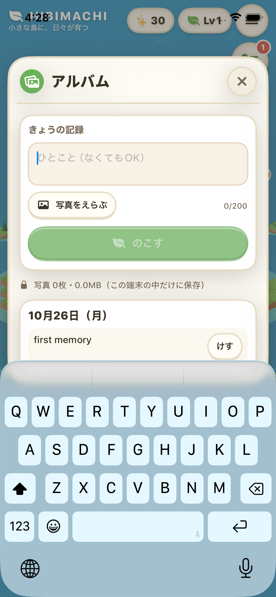

# 2026-10-26 チュートリアル・成長アルバム（P2）・TestFlight準備 作業報告

- 作成日時: 2026年10月26日 13時31分12秒（JST）
- ブランチ / PR: `claude/hibimachi-p0-impl-auviod` / PR #1
- ユーザー決定（2026-10-26）: バンドルID `com.enludus.hibimachi`。残りは「チュートリアル→アルバム→TestFlight準備」の順で全部作ってから TestFlight で確認する。

## 変更（コミット単位）
1. `41d3778` バンドルIDを `com.enludus.hibimachi`（ウィジェット `.widget`、App Group `group.com.enludus.hibimachi`）に変更。
2. `406e6cc` 最初の案内（置く→発見→きょうのこと）。`TutorialGuide`（コア、テスト3件）、とばせる、保存ごとに進み具合を UserDefaults に保存。
3. `1d7dc73` コア: アルバム（`Album`/`MemoryEntry`/`AlbumDay`）、`MediaStore` と `FileMediaStore`、保存 schema v3。テスト10件追加。
4. `721de13` アルバム画面（ひとこと・写真1枚・今日のクエストへのひもづけ・日別の歴史・削除・容量表示）、`PhotoPrep`（1280pxに縮小・EXIF/GPS除去）。
5. `cf77249` TestFlight準備: アプリアイコン（`scripts/art/make_app_icon.py`）、`ITSAppUsesNonExemptEncryption = NO`、手動の `testflight.yml`。
6. `0855123` ADR-0007、ROADMAP・DATA-MODEL・QUALITY-CI・TODO。
7. （本報告と同じコミット）アルバムで保存後にキーボードを閉じる。キーボード表示中に島のヘッダーがステータスバーの下へずれる問題を修正。

## 検証
| 項目 | 結果 |
|---|---|
| `swift test --package-path HibimachiCore`（Linux, Swift 6.3.3） | 117件 PASS |
| format-check / lint（ローカル） | PASS |
| Swift CI（head `0855123`）: Linux / iOS build・app unit・UI test 8件 | success |
| Demo video（head `0855123`） | success |
| UI test: チュートリアル（置くと次へ・とばす・再起動後も出ない） | PASS |
| UI test: アルバム（空では保存不可・保存・2回タップで削除） | PASS |
| 手順7の修正 | 本コミットのCIで確認（この報告の時点では未確認） |

 

## 未実施・残課題
- **TestFlight ワークフローは未実行**（本人の Apple アカウントの Secrets が必要）。初回は App Group の自動登録など署名まわりで失敗する可能性があり、その場合はログを見て直す。
- 写真の選択（PhotosPicker）と縮小・EXIF除去は実機・シミュレータとも自動テストなし（UIテストは文字だけの記録）。
- 写真を iCloud バックアップに含めるか、孤立した写真ファイルの掃除（ADR-0007 の見直し条件）。
- 経済の数値調整・プレイテスト（ROADMAP の残り）は TestFlight 配布後。

## 次に読むもの・コマンド
- `docs/adr/0007-growth-album-local-photos.md`、`docs/QUALITY-CI.md`（TestFlight の Secrets）、`.github/workflows/testflight.yml`
- `swift test --package-path HibimachiCore` / `scripts/ci/swift-quality.sh format-check`
